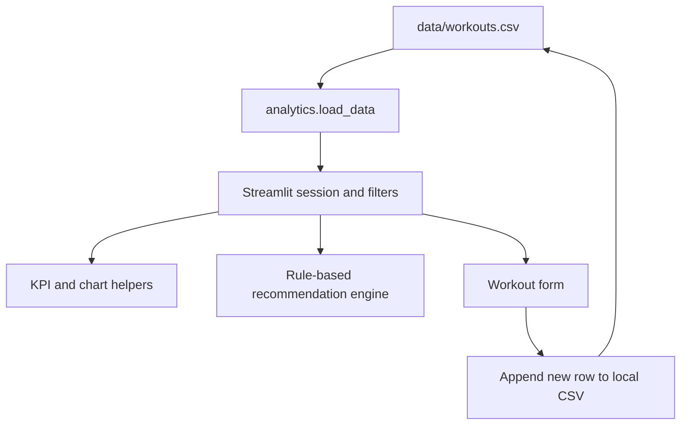

# CaliFit Architecture

## Scope

CaliFit is a local Streamlit dashboard for exploring workout records and
calculating descriptive fitness analytics. It uses generated/sample CSV data by
default. It is an academic visualization project, not a medical or training
program recommendation service.



## Components

- `app.py` configures the Streamlit page, loads the dataset, renders filters and
  dashboard sections, and appends user-entered workout rows to the local CSV.
- `analytics.py` owns CSV loading, user/level filtering, aggregate metrics,
  streak calculations, and Plotly chart builders.
- `recommendation.py` generates rule-based suggestions from the selected level
  and recent workout data. It does not call an AI service.
- `generate_data.py` creates the demonstration dataset when the CSV is absent or
  needs to be regenerated.
- `data/workouts.csv` is a local sample/workout store. A deployment should use a
  user-specific data layer rather than a shared writable repository file.

## Runtime and safety boundary

The application runs in one Streamlit process and has no authentication,
database, or remote API. User-entered rows are written to the local CSV. Do not
place personal health data into a public repository or shared deployment without
adding access control, retention, and privacy handling.

## Verification

The repository currently has no automated test suite. A syntax check is:

```bash
python -m py_compile app.py analytics.py recommendation.py generate_data.py
```

Run locally with `python generate_data.py` followed by `streamlit run app.py`.
